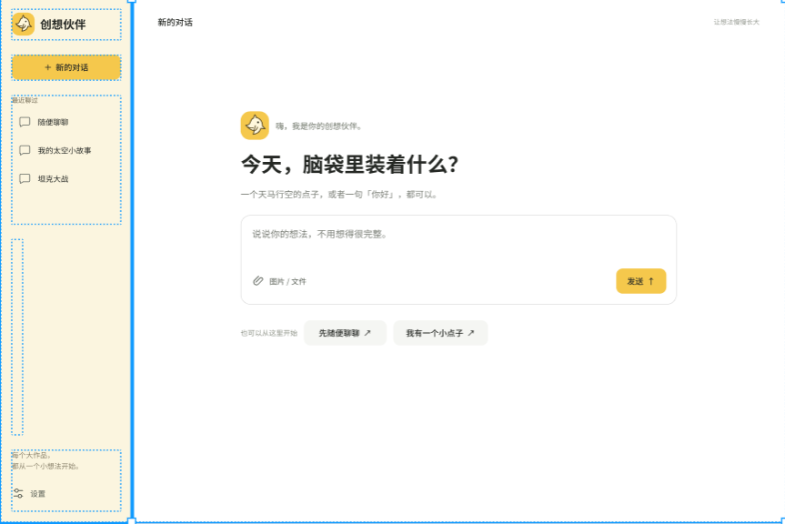
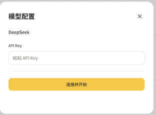
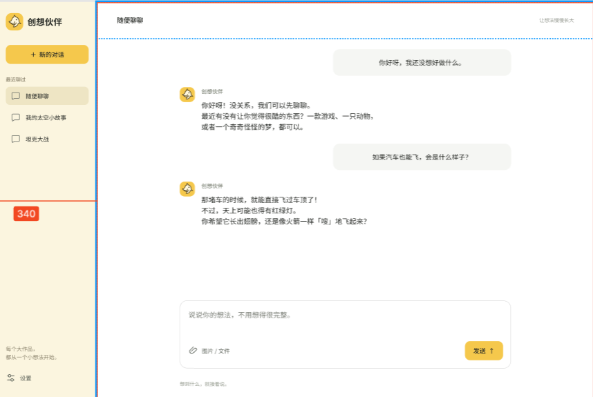
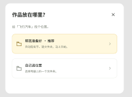
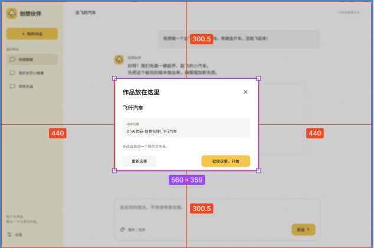
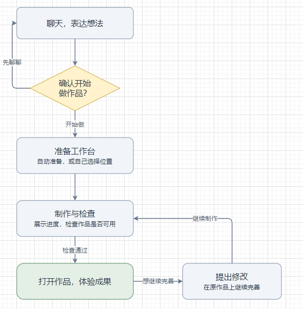
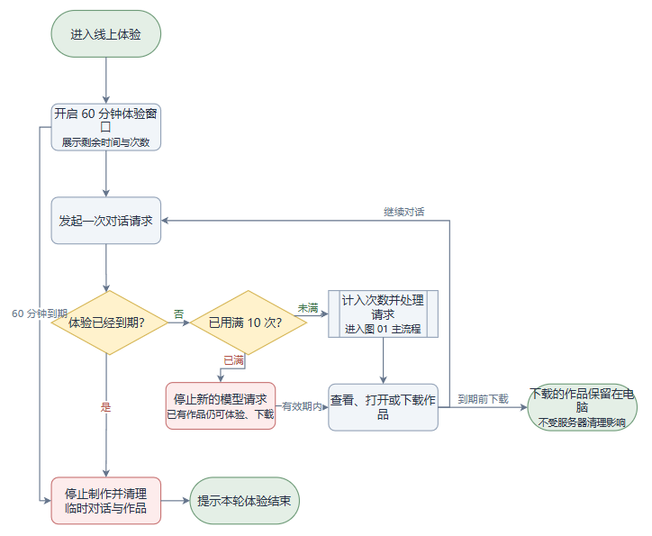

# 创想伙伴 PRD

版本：v1.0

## 一、需求背景与目标

### 1. 目标客户群体：

9—14 岁、缺乏计算机操作及Agent使用经验的青少年

### 2. 使用场景

在AI入门教学及课后自主探索中，孩子尝试通过自然语言让Agent制作小游戏、个人网站等，并在看到成果后继续提出修改要求。

产品重点支持的是独立开发！

### 3. 当前问题

前期实践教学发现，大部分用户即使接受过基础教学，仍难以独立完成创作流程，主要表现为：

- **开始困难：** 不理解模型配置、工作区等概念，容易忘记准备步骤。
- **表达困难：** 需求简短、模糊，难以理解和回答 Agent 的技术性追问。
- **过程难理解：** 等待时不知道制作进展，无法判断是否已经完成。
- **成果难使用：** 不会通过命令启动作品，修改后也容易找不到入口。

### 4. 产品目标

通过简化操作流程、采用易懂的交流方式和提供可直接体验的成果，帮助孩子在尽量少的成人协助下，完成“表达想法—制作作品—打开体验—提出修改”的首次创作闭环，使用Agent的基本信心与兴趣，为后续推出正式的产品积累用户！

## 二、价值判断

**问题是否值得解决：** 值得。初期使用门槛会影响儿童的使用兴趣与意愿，可能使其在体验到创作价值前就放弃，直接影响后续正式Agent 的潜在用户积累。

**现有方案为什么不足：** 通用Agent更多围绕成年人的工作与日常需求设计，即便是豆包，对缺乏电脑使用经验的儿童来说，其Agent模式也是有一定门槛的，尤其是持续使用下的管理！

**预期带来的价值：** 培养并留存一批对Agent创作感兴趣的目标儿童用户，为公司后续正式Agent的推广、灰度测试及需求验证提供用户基础。

**投入是否合理：** 复用现有模型与成熟技术，无需自研底层模型，初期新增投入较低，适合以较小成本开展验证。

## 三、具体方案

### 3.1 本期功能范围

本期围绕“表达想法—确认制作—准备工作台—制作作品—打开体验—继续修改”最小闭环展开！第一版必须完成这个闭环：

| 功能分类 | 本期功能 | 核心要求 |
|---|---|---|
| 模型配置 | 密钥填写、连接验证、保存与清除 | 本地版只需填写 API Key，其他参数默认配置；验证成功后本机保存，后续自动使用。线上体验版使用服务端配置，无需用户填写 |
| 聊天与创作确认 | 普通聊天、创作意图识别、制作确认 | 闲聊不创建项目；明确表达创作需求后展示确认卡，用户确认才进入制作流程，选择“先聊一聊”则继续聊天 |
| 工作台准备 | 自动命名、创建文件夹、自选位置、重名处理 | 根据完整想法提炼作品名称，每个作品使用独立文件夹，不覆盖已有内容；保留原始想法，避免重复输入 |
| 作品制作与修改 | 模糊需求处理、可行性判断、首版制作、持续修改、风格差异化 | 不要求儿童决定技术方案；首版必须可打开、可体验；明显不可行的需求先解释并提供缩小方案；同一作品后续修改保持风格一致 |
| 制作进度 | 阶段展示、等待提示、失败反馈 | 用通俗语言展示当前进展，不展示技术日志或虚假百分比；中间过程进入进度卡，不反复生成聊天消息 |
| 成果交付 | 作品发布、固定入口、再次打开 | 作品可用后展示“打开我的作品”；后续修改沿用入口，不要求儿童输入命令或查找文件；作品尚未可用时不显示可用入口 |
| 会话与素材管理 | 新建及恢复对话、图片和文件上传、作品关联 | 区分普通对话与作品对话，恢复时保留对应关系；上传素材可供当前对话使用，不将附件内容作为系统指令 |

#### 本地版与线上体验版的差异

| 项目 | 本地版 | 线上体验版 |
|---|---|---|
| 模型配置 | 用户填写并保存自己的密钥 | 使用服务端配置的密钥 |
| 作品位置 | 自动创建，或由用户选择存放位置 | 在服务器上自动创建临时工作台，不访问用户电脑磁盘 |
| 制作范围 | 在权限允许的情况下使用本地运行能力 | 限于浏览器可使用的网页作品，不运行系统命令或启动额外服务 |
| 数据保留 | 保存对话与作品，支持后续继续创作 | 体验窗口为 60 分钟，到期清理临时会话与作品 |
| 使用限制 | 不采用线上体验版的固定次数限制 | 每个 60 分钟体验窗口最多发送 10 次对话请求 |
| 成果获取 | 通过作品入口打开，本地保留文件 | 通过作品入口体验，并支持到期前下载作品 |

#### 本期不包含

- 登录注册、会员订阅与付费体系。
- 班级管理、教师后台及多人协作。
- 系统化编程教学、知识测评与学习效果评价。
- 根据话题变化，自动拆分或迁移到新项目。
- 向后续正式 Agent 自动迁移用户、作品或数据；推广与灰度测试的衔接方案另行设计。

### 3.2 业务流程

#### 3.2.1 主流程

用户进入产品后，可以先聊天，也可以提出创作想法。只有确认开始制作后，才创建工作台并进入作品制作流程。

**主路径：**
进入产品 → 表达想法 → 确认制作 → 准备工作台 → 制作与检查 → 打开作品 → 提出修改

| 阶段 | 用户操作 | 系统处理及分支 |
|---|---|---|
| 1. 进入产品 | 打开产品，新建或继续已有对话 | 本地版未配置模型时引导配置，已配置则自动使用；线上体验版无需填写密钥 |
| 2. 表达想法 | 输入文字，可附带图片或文件 | 普通聊天直接回答，不创建作品；明确提出创作需求时进入制作确认；意图不明确时，用简单的话澄清 |
| 3. 确认制作 | 选择“开始做”或“先聊一聊” | 选择“开始做”进入工作台准备；选择“先聊一聊”继续当前对话，不创建文件夹 |
| 4. 准备工作台 | 本地版选择“帮我准备好”或“我自己选择位置” | 提炼作品名称，创建独立文件夹并处理重名，将作品与当前对话绑定；线上版直接准备服务器临时工作台 |
| 5. 开始制作 | 查看自动保留的原始想法，点击“开始制作” | 不要求用户重复描述；判断可行性，明确首版核心体验，分配作品风格并开始制作；过程中持续展示进度 |
| 6. 检查与交付 | 等待制作完成，点击“打开我的作品” | 检查作品能否打开及核心功能是否可用，通过后提供固定入口；未通过则继续修复或说明失败，不能声称已完成 |
| 7. 继续交流或修改 | 体验作品，继续聊天或提出修改要求 | 普通聊天不改动作品；明确的修改要求进入制作与检查流程，沿用原工作台、作品风格和入口，无需重复创建 |

#### 3.2.2 关键分支与异常流程

| 情况 | 处理方式 |
|---|---|
| 想法明显无法在当前条件下完成 | 暂停制作，用通俗语言解释原因，提供 2—3 个保留核心乐趣的缩小方案，等待用户选择 |
| 想法模糊，但可以安全推进 | 系统自行选择合理默认方案，不追问技术实现方式，先完成可体验的第一版 |
| 用户取消工作台准备 | 返回当前对话，保留原始想法，不启动制作，不遗留无用的作品文件夹 |
| 文件夹无法创建或所选位置不可用 | 保留想法，提示重新选择位置或重试，不覆盖已有内容 |
| 模型连接或制作失败 | 明确说明尚未完成及可采取的下一步，保留已有对话和文件，允许继续尝试 |
| 作品修改失败 | 不将失败状态标记为完成；旧作品仍可打开时保留入口，已不可用时明确提示需要修复，不展示为可正常使用 |
| 恢复历史对话 | 恢复对应作品关系；已有作品可继续体验和修改，普通聊天记录不会因此变成作品项目 |

#### 3.2.3 线上体验版补充流程

- 进入体验后展示剩余时间、剩余对话次数及到期清理说明。
- 对话次数用尽后，停止接收新的模型请求；有效期内仍可查看已有成果、打开或下载作品。
- 体验到期后，停止当前制作并清理临时会话与作品，提示本轮体验已结束。
- 用户可在到期前下载作品；下载到自己电脑的文件不受服务器清理影响。

### 3.3页面原型图

#### 3.3.1 聊天主界面

提供新建对话、历史对话、文字输入、图片与文件上传等入口，用户可以先聊天，也可以直接表达创作想法。

#### 3.3.2 模型配置

本地版默认使用 DeepSeek，用户只需填写 API Key，点击“连接并开始”。

#### 3.3.3 普通聊天

用户尚未确定想做什么时，可以继续交流；普通聊天不创建工作台，也不触发作品制作。

#### 3.3.4 作品存放位置选择

确认制作后，提供“帮我准备好”和“自己选位置”两个选项，默认推荐自动准备。

#### 3.3.5 存放位置确认

展示作品名称与保存位置，用户可以重新选择，也可以点击“就放这里，开始”进入制作。

### 3.4流程图

#### 3.4.1 主业务流程

从聊天与表达想法开始，经用户确认后准备工作台、制作并检查作品。检查通过后提供体验入口，后续修改在原作品上继续进行。

#### 3.4.2 线上体验版补充流程

展示 60 分钟体验窗口、10 次对话限制，以及作品体验、下载和到期清理之间的关系。

## 四.数据埋点

需要在以下地方进行数据埋点，以方便统计数据：

用户点击模型配置按钮

用户成功配置模型

系统推荐创建项目

用户点击系统推荐创建按钮，并记录是否为该session的第一次推荐

用户选择自动创建

