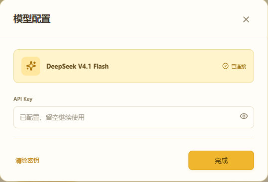
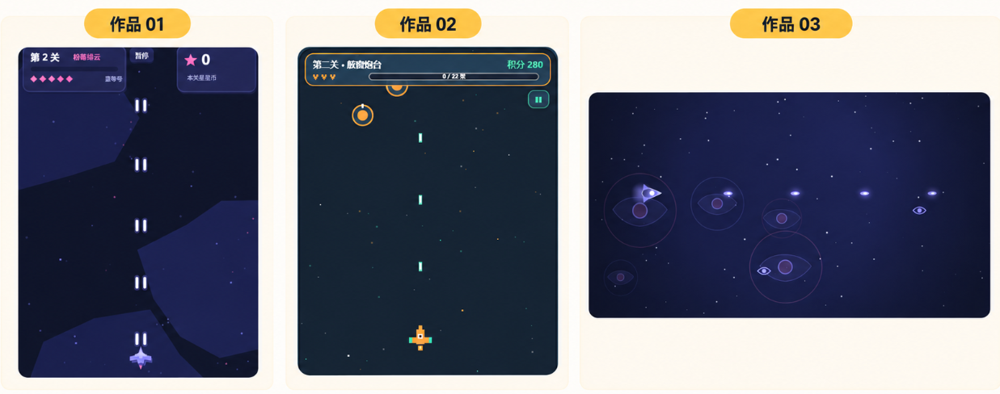
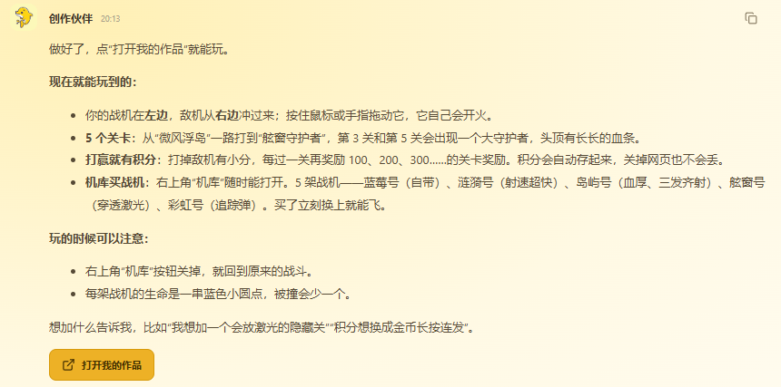
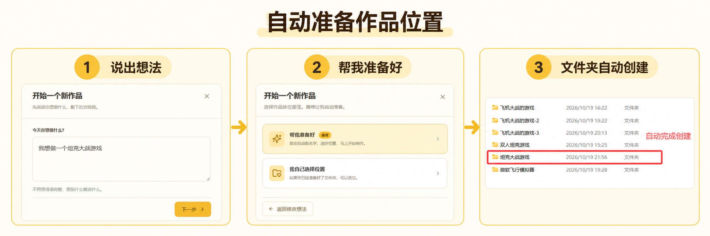

# 创想伙伴：

创想伙伴不追求严丝合缝的 Harness 设计，不追求数量众多的 Tool，也不执着于多 Agent 协作之类的技术炫技。

我们的目标只有一个：让那些连输入一行文字都要停下来想一想的孩子，也能快速体验 Vibe Coding 的快乐，尽快做出真正属于自己的作品，并从中获得成就感。

2026 年 7 月至 8 月，我教会了几十名小学4年级到初二的学生使用workbuddy和codex，我完整提炼并总结了他们在学习和使用时的困难点，并应用在了创想伙伴上。

### 配置困难：

这是第一道门槛，以更好上手的workbuddy为例，我需要告诉他们如何选择模型，如何填写api_key，不同的服务应该如何购买！但现实情况是，他们或是没有手机、或是记不住填写步骤，又或是不知道如何选择模型！

回到他们最根本的诉求，其实就是能够有一个大模型接入进来能够实现他们的想法就行了，他们不在乎token本身，没钱了就让妈妈充值！也不在乎哪个模型更聪明、更不关心为什么要设置推理强度，这到底是个什么东西？ 

我们使用最极简的配置方法，进入我们的项目，只需要一份deepseek的api_key填写进来就能完成所有配置。



【模型的默认选择ds-flash，推理强度为高，且为防止token被单一任务无限次调用，外层设计了熔断机制】


### 作品容易同质化：

孩子们提出的需求经常非常相似，例如“做一个飞机大战”或“做一个坦克游戏”。如果只把这些话直接交给通用模型，它很容易反复生成相同的渐变背景、卡片布局和按钮样式【尤其是暗黑渐变色的背景，vibe coder都懂的😂】

仅仅在提示词中要求“做得有创意”并不可靠，因为模型对“有创意”的理解并不稳定，也无法记住其他孩子刚刚做过什么。

因此，创想伙伴会在代码层面为每个新作品生成一张独立的“创意身份卡”。它由配色、世界背景、图形风格、动画感觉和页面布局共同组成。这些元素不是毫无规则地随机产生，而是从人工筛选过的方案中进行组合。程序还会检查最近创建的作品，尽量避开已经使用过的相同组合。

创意身份生成后会与作品一起保存。以后无论增加角色、技能还是新页面，创想伙伴都会继续沿用同一种视觉语言，避免同一个作品在多次修改后变得前后不一致。

```python
PALETTES = [
    {"name": "汽水星球", "background": "#081A2B", "surface": "#12324A", "primary": "#38D6C7", "accent": "#FFD166", "text": "#F4FBFF"},
    {"name": "草莓晚霞", "background": "#27152F", "surface": "#4A2448", "primary": "#FF718D", "accent": "#FFC857", "text": "#FFF7F2"},
..............
]

WORLDS = ["漂浮岛屿", "积木城市", "深海基地", "纸片宇宙", "糖果工厂", "机械森林"]
SHAPES = ["圆润气泡", "像素积木", "剪纸层次", "太空舷窗", "漫画分镜", "卡片拼图"]
MOTIONS = ["轻快弹跳", "柔和漂浮", "有力推进", "像素闪烁", "卡片翻转", "涟漪扩散"]
LAYOUTS = ["中央舞台", "左右对战", "纵向闯关", "环形仪表", "漫画分区", "自由探索"]
```

```python
prompt = config["system_prompt"] + "\n\n" + skill + (
                f"\n当前作品文件夹：{session['workspace']}。文件能力仅使用相对路径。"
                f"\n孩子最初的想法：{project.get('idea', text or '')}"
                "\n本作品的创意身份（必须持续遵守）：\n" + json.dumps(project.get("fingerprint", {}), ensure_ascii=False) + .....)
```

我们来看实测案例，用完全一模一样的一段提示词生成的效果：

```
prompt:我要做一个飞机大战的游戏，要能闯关，闯关完后要有积分，积分能购买战机。
```




### 交付必须简单到只需点一下

这是非常容易被忽视，但对体验感非常重要的一个点。我在教成年人使用时，他们经常发出疑惑：AI说他做好了，但是他要我启动什么bat/py什么的，我怎么弄啊!

因此，创想伙伴会尽量把作品包装成浏览器可以直接打开的页面，并始终保留“打开我的作品”按钮。即使后续继续修改，也沿用同一个入口，不要求孩子寻找文件、输入命令或手动启动程序。

在创想伙伴中，真正的完成不是“文件已经生成”，而是“小朋友点一下就能使用”。

只要是已经有现成的作品了，我们是强制会携带上打开作品按钮的



即便是底层实现是用python、JAVA等实现，我们都会尽量封装成web可视化端口来进行展示。


### 自动准备作品位置：

小朋友通常没有主动创建和整理文件夹的习惯。即使提前教过，他们也可能忘记创建，或者把作品随意放在桌面和C盘中。

因此，新建作品时，创想伙伴会先询问孩子想做什么，再推荐“帮我准备好”。程序会自动命名并创建专属文件夹，然后把孩子刚才说的想法带入聊天框。孩子不需要寻找目录，也不需要把需求再说一遍。



### 使用成熟的第三方库：

尽量使用成熟的第三方库来实现需求，但你以为这么做是为了缩短时间吗？其实这只是一方面，更为重要的一方面**生成出来的产品要成熟得多！**这才是关键，不要小瞧小朋友们的需求，他们不再是写一个像素马里奥、简单的飞机大战就能被满足的，多数小朋友是追求画面和可玩性的。比如他们在做人体识别项目时，对同步要求是非常高的，稍微卡顿一点都会觉得是没有做好，所以使用成熟的第三方库，例如MediaPipe这种开箱即用的库，又快质量又高。

### 听不懂技术名词

一个真实的例子是：有个小朋友想制作一架空客飞机的3D模型。WorkBuddy 最初尝试使用 CSS 和 JS实现，但做出来的模型非常粗糙。孩子表示不满意后，WorkBuddy 又问他：“那我们改用 Blender或者xxxx？”

这种回复直接就让小朋友看不懂了，已经不知道怎么回复了，只能求助我。

我后续采用的办法是：提前准备一段话，让每个孩子在第一节课开始前复制发送给 AI。

> 我是一名刚开始学习 AI 的小学生，很多技术名词都听不懂。请使用简单的话回答我，并把这条要求作为长期记忆

这种方法在课堂上暂时有效，但并不适合作为长期方案。小朋友对电脑和 AI 的理解会不断提高。如果这段话被长期保存在个人账号中，它就可能在未来变成一条过时的限制。

因此，创想伙伴没有把“孩子不懂技术”保存成用户的长期记忆，而是直接将它作为产品默认遵守的交流规则，写在skill和系统提示词中：


### 想法丰富，但描述往往很短

小朋友提出需求时，通常只会说出一句非常简短的话。

在开始培训之前，我以为只要教会他们基本的使用方法，他们很快就能学会编写 Prompt，甚至可以组队完成更复杂的作品。我们第一期还进行了分小组组队的实验。但真正开始教学后，我发现事情并没有这么简单。

孩子缺少的往往不是想象力，而是把脑海中的画面整理成完整说明的能力。他可能已经想象出在xx情况下战斗机可以喷火，或者有保护机制、不断变化的天空和大Boss，但真正说出口的只有一句：

> 我想做一个飞机大战。他要能喷火，然后环境要变化，要能打怪兽！

如果这时继续追问他想要什么画面风格、使用什么工具、怎样控制角色，孩子通常无法回答。问题问得越多，他越容易觉得创作是一件很困难的事情，最初的兴趣也会慢慢消失。

传统的通用 Agent 遇到模糊需求时，往往会继续追问细节。

因此，创想伙伴不会要求孩子先学会写出一段完整、规范的 Prompt。收到一句模糊的想法后，它会先找出其中最重要的部分：

- 孩子想做什么？
- 这个作品最核心的动作是什么？
- 孩子特别强调了什么？

对于不会改变作品方向的细节，创想伙伴会自行作出合理选择，先完成一个能够打开、看到并操作的第一版。孩子看到作品后，再通过几个简单、具体的选项，决定下一步想增加什么。

孩子不需要先学会准确地描述一切，也可以从一句简单的想法开始创作。


